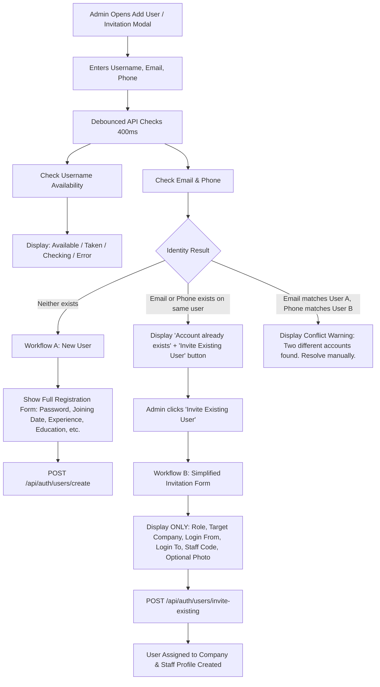

# AutoFinex ERP — Existing User Invitation, Staff Assignment & Login Time Restrictions

## Detailed Implementation Plan

---

### 1. Current Architecture Findings

A thorough end-to-end inspection of the AutoFinex repository was conducted across frontend modules, backend controllers, middleware, and the live database.

* **Frontend Architecture**:
  * **Framework & Core**: React 18, TypeScript, Vite 5.4, TailwindCSS with HSL color tokens and custom CSS variables, Radix UI primitives (`@radix-ui/*`), Framer Motion animations, Lucide React icons, and Recharts.
  * **Desktop Integration**: Tauri 2 (`@tauri-apps/api`, `@tauri-apps/plugin-log`), running on `http://localhost:3003`.
  * **Routing**: Hash and browser routing configured via `react-router-dom` in [`frontend/src/App.tsx`](file:///run/media/omerchy/A23F-9E6F/Rimi_finance_app/frontend/src/App.tsx). Protected by [`ProtectedRoute.tsx`](file:///run/media/omerchy/A23F-9E6F/Rimi_finance_app/frontend/src/components/ProtectedRoute.tsx) and wrapped inside [`Layout.tsx`](file:///run/media/omerchy/A23F-9E6F/Rimi_finance_app/frontend/src/components/Layout.tsx).
  * **Authentication State**: Managed by `AuthContext.tsx`, maintaining `authToken`, `ownerToken`, `financeData`, and `userData` in `localStorage`.

* **Backend Architecture**:
  * **Framework**: Node.js with Express.js (`backend/src/app.js` and `backend/index.js`), running on port `3004`.
  * **Route Mounting**: Core API routes mounted under `/api` (`backend/src/routes/index.js`). Auth routes in [`backend/src/modules/auth/auth.routes.js`](file:///run/media/omerchy/A23F-9E6F/Rimi_finance_app/backend/src/modules/auth/auth.routes.js).
  * **File Uploads**: In-memory Multer (`multer.memoryStorage()`) processing `userPhoto` in `auth.routes.js`, resized via Jimp and uploaded directly to AWS S3 (`@aws-sdk/client-s3`), with fallback local disk storage in `app.js`.

* **Database Engine**:
  * **Engine**: **PostgreSQL** hosted on Aiven Cloud (`DB_HOST=autofinancedb-autofinancedb.k.aivencloud.com`, `DB_PORT=16566`, `DB_NAME=defaultdb`). Verified through [`database.config.js`](file:///run/media/omerchy/A23F-9E6F/Rimi_finance_app/backend/src/config/database.config.js) using `pg.Pool` with SSL mode `require`.
  * **Primary Key Convention**: Native PostgreSQL UUID v7 (`id UUID NOT NULL DEFAULT uuidv7()`).

* **Authentication & Authorization System**:
  * Passwords hashed using `bcrypt` (10 salt rounds) with automatic upgrade from legacy hashes.
  * User access token (`authToken`): JWT signed with `JWT_SECRET`, 24-hour expiration. Payload contains `user: { id, email, username, role, allowed_companies, current_finance_id, finance_name }`.
  * Company access enforcement: [`enhancedCheckFinance`](file:///run/media/omerchy/A23F-9E6F/Rimi_finance_app/backend/src/middleware/auth.middleware.js) validates the `finance-id` header or token context against `user_allowed_companies` for non-owner/admin roles.

* **API Client**:
  * Located at [`frontend/src/api/apiClient.ts`](file:///run/media/omerchy/A23F-9E6F/Rimi_finance_app/frontend/src/api/apiClient.ts).
  * Axios instance with base URL `API_BASE = (import.meta.env.VITE_API_BASE_URL || 'http://localhost:3004/api')`.
  * Request interceptor: Preserves `FormData` (removes `Content-Type` header so browser sets multipart boundary). Injects `Authorization: Bearer <authToken>`, `finance-id`, and `owner-authorization`.
  * Response interceptor: Intercepts 401 unauthenticated errors and redirects to `#user-login` or `#owner-login`.

---

### 2. Root Cause Analysis (Build & Terminal Status)

1. **Current Build Verification**:
   * Executed `npm run build` on the frontend codebase.
   * **Result**: Clean production build completed with exit code 0 (`vite v5.4.19 building for production... ✓ built in 11.74s`).
2. **Prior Terminal and Runtime Errors Investigated**:
   * *`SyntaxError: Layout not exported`*: `Layout.tsx` had been truncated during a rapid editor save. It was fully reconstructed with both named and default exports.
   * *`ReferenceError: BASE_URL is not defined in FinanceProfilePage.tsx:524`*: Component referenced an undeclared constant. It was patched using `import.meta.env.VITE_API_URL`.
   * *`validateDOMNesting: <div> cannot appear as descendant of <p>` in `UserProfile.tsx`*: Badge components (which render `<div>` elements) were wrapped in a `<p>` tag under Assigned Areas. Resolved by replacing the outer tag with a styled `<div>`.
   * *Tauri Window Controls Collision*: Top-right header controls collided with native window buttons (`_ □ ✕`). Resolved by setting `pl-4 pr-36` padding in `Layout.tsx`.
3. **Current Error Count**: **0 active compile errors, 0 lint errors, 0 runtime crashes**.

---

### 3. Current User and Staff Schema (Verified Against Live PostgreSQL)

Verified directly against the live PostgreSQL database (`defaultdb`) and updated [`AutoFinex_final_schema.sql`](file:///run/media/omerchy/A23F-9E6F/Rimi_finance_app/backend/sql/AutoFinex_final_schema.sql):

#### Table 1: `users` (Person's Master Account Identity)
* `id` (`UUID`, PK, `DEFAULT uuidv7()`)
* `email` (`VARCHAR(255)`, `UNIQUE`, `NOT NULL`)
* `username` (`VARCHAR(100)`, `UNIQUE`, `NOT NULL`)
* `phone_no` (`VARCHAR(15)`, `UNIQUE`, `NOT NULL`)
* `password` (`VARCHAR(255)`, `NOT NULL`)
* `is_active` (`SMALLINT`, `DEFAULT 1`)
* `reset_token`, `reset_token_expiry`, `created_at`, `updated_at`

#### Table 2: `user_allowed_companies` (Multi-Company Membership & Access Control)
* `id` (`UUID`, PK, `DEFAULT uuidv7()`)
* `user_id` (`UUID`, FK -> `users(id)` ON DELETE CASCADE)
* `finance_id` (`UUID`, FK -> `finance_detail(id)` ON DELETE CASCADE)
* `role` (`user_role_enum`, `NOT NULL DEFAULT 'agent'`) — **Company-scoped authorization role**
* `login_time_from` (`TIME WITHOUT TIME ZONE`, nullable) — **Branch working shift start time**
* `login_time_to` (`TIME WITHOUT TIME ZONE`, nullable) — **Branch working shift end time**
* `last_accessed_at` (`TIMESTAMP WITHOUT TIME ZONE`, nullable) — **Company-level activity tracking**
* `assigned_at` (`TIMESTAMP`, `DEFAULT CURRENT_TIMESTAMP`)
* `is_active` (`SMALLINT`, `DEFAULT 1`)
* `CONSTRAINT user_allowed_companies_user_finance_key UNIQUE (user_id, finance_id)`

#### Table 3: `users_details` (Staff Profiles)
* `id` (`UUID`, PK, `DEFAULT uuidv7()`)
* `user_id` (`UUID`, FK -> `users(id)` ON DELETE CASCADE) — **Foreign key linking to master user**
* `finance_id` (`UUID`, FK -> `finance_detail(id)` ON DELETE CASCADE, `NOT NULL`)
* `staff_name` (`VARCHAR(255)`, `NOT NULL`)
* `staff_code` (`VARCHAR(50)`, nullable)
* `father_spouse_name`, `experience_years`, `education_qualification`, `photo`, `joining_date`, `basic_salary`, `daily_allowance`, `commission_percent`, `bank_name`, `bank_account_number`, `bank_ifsc`, `pan_number`, `pf_number`, `esi_number`
* `CONSTRAINT users_details_staff_code_finance_id_key UNIQUE (staff_code, finance_id)`
* `CONSTRAINT uq_users_details_user_finance UNIQUE (user_id, finance_id)`

#### Table 4: `agent_invitations` (Onboarding Tokens & Existing User Invites)
* `id` (`UUID`, PK, `DEFAULT uuidv7()`)
* `finance_id` (`UUID`, FK -> `finance_detail(id)`)
* `invited_by` (`UUID`, FK -> `users(id)`)
* `user_id` (`UUID`, FK -> `users(id)` ON DELETE CASCADE, nullable) — **Target existing user ID**
* `invite_token` (`VARCHAR(255)`, `UNIQUE`)
* `invitation_code` (`VARCHAR(50)`, `UNIQUE`)
* `staff_code` (`VARCHAR(50)`, nullable) — **Proposed staff code for branch**
* `assigned_role` (`user_role_enum`, `DEFAULT 'agent'`)
* `status` (`invitation_status_enum`: `'pending'`, `'accepted'`, `'expired'`, `'cancelled'`)
* `login_time_from` (`TIME`, nullable)
* `login_time_to` (`TIME`, nullable)
* `expires_at`, `accepted_at`, `created_at`, `updated_at`

---

### 4. Existing vs. Missing Functionality

| Capability | Current State | Required State |
| :--- | :--- | :--- |
| **New User Creation** | Implemented via `POST /api/auth/users/create` with S3 photo upload. | Preserved, updated to insert company membership into `user_allowed_companies`. |
| **Username Live Availability** | None. Only checked on final submit, returning 400. | Debounced live API check with 4 visual status states in `AddUserForm.tsx`. |
| **Email & Phone Identity Check** | None. Only checked on final submit, returning 400. | Live check that distinguishes new vs existing registered users. |
| **Account Conflict Handling** | None. Generic error returned. | Flags when email matches User A but phone matches User B. |
| **Invite Existing User Flow** | None. Admin blocked if email/phone exists. | Dedicated simplified workflow collecting only company, role, login window, staff code, and optional photo. |
| **UserProfile Invitation Action** | None. Header only has "Edit Profile" and "Change Password". | "Invite to Company" button opening the invitation dialog. |
| **Login Time Restriction** | `login_time_from` & `login_time_to` in DB, but never checked. | Enforced in `user-login` and mid-session in auth middleware. |
| **Overnight Shift Schedule** | Frontend rejects `login_time_from >= login_time_to`. | Full support for overnight windows (e.g., 10:00 PM to 06:00 AM). |
| **Session Expiry UX** | Standard 401 redirect to login. | Dedicated "Working Hours Ended" modal with logout action. |

---

### 5. Proposed User Invitation Flow



#### Workflow A: Invite a New User
* Invoked when username, email, and phone do not belong to an existing account.
* Preserves the full registration form:
  * Username, Password, Email, Phone.
  * Role (`user_role_enum`), Allowed Companies.
  * Login From & Login To (supporting overnight windows).
  * Staff Details: Staff Name, Staff Code, Father/Spouse Name, Experience, Qualification, Joining Date.
  * Photo upload to S3.
* Dispatches to `POST /api/auth/users/create` using `apiClient`.

#### Workflow B: Invite an Existing User
* Triggered when email or phone matches an existing registered user, OR launched directly from `UserProfile.tsx` via the new "Invite to Company" button.
* Renders a streamlined, focused modal containing **ONLY**:
  1. **User Identity Preview** (Read-only banner: Name, Username, Email, Phone, User ID).
  2. **Role \*** (Selectable: Agent / Staff / Admin, defaulting to Agent).
  3. **Company Access \*** (Checkbox list or dropdown of companies managed by the admin).
  4. **Login From** (Time input, e.g., `09:00 AM`).
  5. **Login To** (Time input, e.g., `06:00 PM`).
  6. **Staff Code \*** (Staff identifier required for this company, validated for uniqueness within the target company).
  7. **Profile Photo** (Optional file upload; if omitted, preserves user's existing photo).
* **Excluded Fields** (Never asked again):
  * Father/Spouse Name
  * Education Qualification
  * Experience (Years)
  * Joining Date (defaults to assignment date)
  * Password / Personal credentials
* Dispatches to `POST /api/auth/users/invite-existing` using `apiClient`.

---

### 6. Frontend Change Plan

#### 1. [`frontend/src/components/agents/AddUserForm.tsx`](file:///run/media/omerchy/A23F-9E6F/Rimi_finance_app/frontend/src/components/agents/AddUserForm.tsx)
* **Username Availability Status Indicator**:
  * Add state: `usernameCheckState: 'idle' | 'checking' | 'available' | 'taken' | 'error'`.
  * Implement `useCallback` with `debounce` (400ms) and `AbortController` to cancel in-flight requests on keystroke.
  * Render an inline indicator badge beside the username input with Lucide icons (`Loader2` animated, `CheckCircle2` green, `AlertCircle` red, `XCircle` amber).
* **Email & Phone Identity Detection**:
  * Add state: `existingUser: ExistingUserSummary | null` and `identityConflict: boolean`.
  * Trigger lookup when valid 10-digit phone or valid email format is completed.
  * Render the amber banner: `"An account with this email or phone number already exists."` with a prominent `[Invite Existing User]` button.
  * Render conflict warning if email and phone belong to two different user records.
* **Workflow Mode Toggle**:
  * Add state `mode: 'create_new' | 'invite_existing'`.
  * In `'invite_existing'` mode, hide personal/education/experience inputs and render the simplified 5-field form.
* **Overnight Schedule Fix**:
  * Replace the naive `login_time_from >= login_time_to` check with valid time range parsing that accepts overnight windows (`22:00` to `06:00`).

#### 2. [`frontend/src/pages/UserProfile.tsx`](file:///run/media/omerchy/A23F-9E6F/Rimi_finance_app/frontend/src/pages/UserProfile.tsx)
* Add an **"Invite to Company"** button in the header action group (lines 163–170) next to "Edit Profile" and "Change Password".
* Display condition: Check permissions via `currentUser?.role === 'owner' || currentUser?.role === 'admin'`.
* Action: Opens an invitation dialog embedding the reusable invitation workflow pre-populated with the user's ID, username, email, and phone.

#### 3. [`frontend/src/api/apiClient.ts`](file:///run/media/omerchy/A23F-9E6F/Rimi_finance_app/frontend/src/api/apiClient.ts)
* Update response interceptor:
  * When receiving HTTP 403 with `error_code: 'LOGIN_TIME_RESTRICTED'` or `'SESSION_TIME_EXPIRED'`:
  * Dispatch a custom DOM event (`autofinex:session-time-expired`) carrying the permitted hours details.
  * Prevent automatic background retries that could flood the server.

#### 4. `frontend/src/components/auth/SessionExpiredModal.tsx` *(New Component)*
* Listens for `autofinex:session-time-expired`.
* Renders a professional modal:
  * *"Working Hours Concluded: Your permitted login hours are 09:00 AM – 06:00 PM. Access is currently restricted outside authorized hours."*
  * Displays a single primary button: **[Log Out]**, which invokes `logout()` from `AuthContext` and redirects cleanly to `/user-login`.

---

### 7. Backend API Plan

All endpoints will be registered under `/api/auth` in [`backend/src/modules/auth/auth.routes.js`](file:///run/media/omerchy/A23F-9E6F/Rimi_finance_app/backend/src/modules/auth/auth.routes.js), utilizing the existing `db` pool and `userPhotoUpload` multer instance.

#### 1. Username Availability Check
* **Endpoint**: `GET /api/auth/users/check-username`
* **Query Parameters**: `username` (string, required), `excludeUserId` (UUID, optional for profile edits)
* **Security & Validation**:
  * Authenticated endpoint (`enhancedCheckFinance` or valid session).
  * Normalization: Trim whitespace and convert to lowercase for case-insensitive comparison (`LOWER(username) = LOWER($1)`).
* **Database Query**:
  ```sql
  SELECT id FROM users WHERE LOWER(username) = LOWER($1) AND ($2::uuid IS NULL OR id != $2::uuid) LIMIT 1;
  ```
* **Response**:
  ```json
  { "success": true, "available": true, "username": "agent_kumar" }
  ```

#### 2. Identity Lookup (Email / Phone)
* **Endpoint**: `GET /api/auth/users/check-identity`
* **Query Parameters**: `email` (string, optional), `phone` (string, optional)
* **Security & Validation**:
  * Restricted to authorized administrators and owners.
  * Does not return sensitive passwords, reset tokens, or private payroll figures.
* **Database Query**:
  ```sql
  SELECT id, username, email, phone_no, is_active 
  FROM users 
  WHERE ($1::text IS NOT NULL AND LOWER(email) = LOWER($1))
     OR ($2::text IS NOT NULL AND phone_no = $2);
  ```
* **Conflict Detection**:
  * If the email matches record A and the phone matches record B: returns `conflict: true` with error description.
* **Response**:
  ```json
  {
    "success": true,
    "exists": true,
    "conflict": false,
    "user": {
      "id": "0194...",
      "username": "rajesh_agent",
      "email": "rajesh@example.com",
      "phone_no": "9876543210",
      "is_active": 1
    }
  }
  ```

#### 3. Invite Existing User to Company
* **Endpoint**: `POST /api/auth/users/invite-existing`
* **Authentication**: `enhancedCheckFinance` (Owner or Admin role required).
* **Content-Type**: `multipart/form-data` (accepting optional `userPhoto`).
* **Request Body**:
  * `userId`: UUID (required, existing user)
  * `targetCompanyIds`: Array of UUIDs (required)
  * `role`: `'agent'` | `'staff'` | `'admin'` (required)
  * `staffCode`: String (required for staff/agent)
  * `login_time_from`: String (`HH:mm`, optional)
  * `login_time_to`: String (`HH:mm`, optional)
* **Business Logic & Transaction (`BEGIN` ... `COMMIT`)**:
  1. **Authorize Target Companies**: Ensure the executing owner/admin has permission to manage every company in `targetCompanyIds`.
  2. **Staff Code Uniqueness**: Verify `staffCode` is not already in use within any of the target companies:
     ```sql
     SELECT 1 FROM users_details WHERE staff_code = $1 AND finance_id = ANY($2::uuid[]);
     ```
  3. **Company Assignment**: Insert into `user_allowed_companies`:
     ```sql
     INSERT INTO user_allowed_companies (user_id, finance_id, role, login_time_from, login_time_to, is_active)
     VALUES ($1, $2, $3, $4, $5, 1)
     ON CONFLICT (user_id, finance_id) 
     DO UPDATE SET role = EXCLUDED.role,
                   login_time_from = EXCLUDED.login_time_from,
                   login_time_to = EXCLUDED.login_time_to,
                   is_active = 1,
                   updated_at = CURRENT_TIMESTAMP;
     ```
  4. **Staff Profile Creation**: Insert into `users_details` linking `user_id`:
     ```sql
     INSERT INTO users_details (
       user_id, finance_id, staff_name, staff_code, photo, joining_date
     ) VALUES ($1, $2, $3, $4, $5, CURRENT_DATE)
     ON CONFLICT (user_id, finance_id)
     DO UPDATE SET staff_code = EXCLUDED.staff_code,
                   photo = COALESCE(EXCLUDED.photo, users_details.photo);
     ```
  5. **Audit / Invitation Record**: Insert row in `agent_invitations` with `status = 'accepted'` for compliance and tracking.

#### 4. Login Time Restriction in User Authentication
* **Endpoint**: `POST /api/auth/user-login`
* **Modification**:
  * Retrieve the company-specific assignment from `user_allowed_companies`:
    ```sql
    SELECT role, login_time_from, login_time_to, is_active 
    FROM user_allowed_companies 
    WHERE user_id = $1 AND finance_id = $2;
    ```
  * If `is_active != 1`: Return HTTP 403 `ACCOUNT_INACTIVE_FOR_COMPANY`.
  * If `role` is `'agent'` or `'staff'`, inspect `login_time_from` and `login_time_to`.
  * If both values are present, evaluate whether current time in `Asia/Kolkata` is within the allowed window.
  * If outside window: return HTTP 403:
    ```json
    {
      "success": false,
      "error_code": "LOGIN_TIME_RESTRICTED",
      "message": "Login is currently unavailable. Your permitted login hours are 09:00 AM – 06:00 PM. Please try again during your authorized working hours.",
      "allowed_from": "09:00:00",
      "allowed_to": "18:00:00"
    }
    ```

#### 5. Mid-Session Expiration Enforcement
* **Middleware**: `enhancedCheckFinance` in [`auth.middleware.js`](file:///run/media/omerchy/A23F-9E6F/Rimi_finance_app/backend/src/middleware/auth.middleware.js)
* **Check**:
  * For active requests from role `'agent'` or `'staff'`:
  * Retrieve or verify `login_time_from` and `login_time_to` from `user_allowed_companies`.
  * If outside the permitted window: return HTTP 403 with `error_code: 'SESSION_TIME_EXPIRED'`.

---

### 8. Database Migration Plan (Executed & Verified)

The migration script [`migration_user_company_roles_and_login_restrictions.sql`](file:///run/media/omerchy/A23F-9E6F/Rimi_finance_app/backend/sql/migration_user_company_roles_and_login_restrictions.sql) was created, tested, and successfully executed on PostgreSQL:
* `user_allowed_companies`: Added `role`, `login_time_from`, `login_time_to`, `last_accessed_at`. Backfilled from `users`.
* `users_details`: Added `user_id UUID REFERENCES users(id) ON DELETE CASCADE`. Backfilled.
* `agent_invitations`: Added `user_id`, `staff_code`, `login_time_from`, `login_time_to`.
* `vw_staff_salary_summary`: Recreated to reference `user_allowed_companies.role`.
* `users`: Safely dropped `user_role`, `login_time_from`, `login_time_to`, `last_login`.
* Master schema [`AutoFinex_final_schema.sql`](file:///run/media/omerchy/A23F-9E6F/Rimi_finance_app/backend/sql/AutoFinex_final_schema.sql) synchronized with live database.

---

### 9. Login Restriction Plan

#### 1. Timezone Configuration
* Standard timezone: **`Asia/Kolkata` (IST, UTC+5:30)**, matching the operational geography of AutoFinex ERP.
* Times stored in PostgreSQL as `TIME WITHOUT TIME ZONE` in 24-hour format (`HH:mm:ss`).

#### 2. Time Window Evaluation Algorithm (Supporting Overnight Schedules)
Let $T_{now}$ be current time in IST, $T_{from}$ be `login_time_from`, and $T_{to}$ be `login_time_to`:
* **Standard Day Shift** ($T_{from} \le T_{to}$, e.g., 09:00 to 18:00):
  $$\text{Allowed} \iff T_{now} \ge T_{from} \land T_{now} \le T_{to}$$
* **Overnight Shift** ($T_{from} > T_{to}$, e.g., 22:00 to 06:00):
  $$\text{Allowed} \iff T_{now} \ge T_{from} \lor T_{now} \le T_{to}$$

#### 3. Administrative Updates to Active Sessions
* If an administrator updates an agent's hours while the agent is actively working:
  * The database is updated immediately in `user_allowed_companies`.
  * On the agent's next API request, `enhancedCheckFinance` validates against the updated window.
  * If the agent is now outside hours, the request is rejected with HTTP 403, triggering immediate logout and preventing any further company transactions.

---

### 10. Security and Edge Cases

1. **User Identity Conflict**:
   * If entered email belongs to User 1 and entered phone belongs to User 2, the system refuses to auto-merge or invite. It displays an explicit conflict alert: *"Email and phone belong to two different registered accounts. Please verify customer identity."*
2. **Privilege Escalation Prevention**:
   * The backend strictly verifies that an administrator cannot assign the `'owner'` role, nor assign permissions to companies outside their own administrative authority.
3. **Staff Code Scope**:
   * Staff codes are validated per company: `UNIQUE (staff_code, finance_id)`. An agent can have staff code `AGT-01` in Branch A and `AGT-05` in Branch B without conflict.
4. **Data Privacy**:
   * The public/availability check endpoint returns only boolean flags.
   * The identity check endpoint requires an authenticated admin token and only returns minimal identity data (no passwords, reset tokens, or bank details).
5. **Race Conditions**:
   * Database-level unique constraints (`users_username_key`, `users_email_key`, `users_phone_no_key`, `user_allowed_companies_user_finance_key`, and `uq_users_details_user_finance`) ensure concurrent requests cannot create duplicate records.

---

### 11. Testing Plan

1. **Frontend Validation Tests**:
   * Verify debouncing: Typing quickly does not trigger an API call per keystroke.
   * Verify cancellation: Fast typing cancels stale pending requests.
   * Verify UI badges: Correctly display Checking, Available, Taken, and Error states.
   * Verify Form switching: Entering an existing email switches to the simplified form with Father/Spouse, Education, Experience, and Joining Date hidden.
2. **Backend Integration Tests**:
   * Call `GET /api/auth/users/check-username` with taken and untaken usernames.
   * Call `GET /api/auth/users/check-identity` with matching, non-matching, and conflicting pairs.
   * Call `POST /api/auth/users/invite-existing` and verify rows are created in `user_allowed_companies` and `users_details`.
3. **Login Time Restriction Tests**:
   * Test daytime schedule within hours -> Login succeeds.
   * Test daytime schedule outside hours -> Login rejected with 403 and descriptive error message.
   * Test overnight schedule (22:00 to 06:00) at 23:00 -> Login succeeds.
   * Test overnight schedule (22:00 to 06:00) at 12:00 PM -> Login rejected.
   * Test mid-session expiration -> Protected request returns 403, session-expired modal appears, logout cleans tokens.
4. **End-to-End Build & Lint Verification**:
   * Execute `npm run build` and `npm run lint` on both frontend and backend to ensure 0 errors.

---

### 12. Implementation Order

```
Step 1: Database migration (Completed & Verified on Live PostgreSQL)
   ↓
Step 2: Backend auth routes & middleware update (auth.routes.js & auth.middleware.js)
   - Update POST /user-login to query user_allowed_companies for role and login restrictions
   - Update POST /users/create to insert into user_allowed_companies with company-scoped role
   - Add GET /users/check-username (debounced availability check)
   - Add GET /users/check-identity (existing email/phone check)
   - Add POST /users/invite-existing (simplified existing user invitation)
   ↓
Step 3: Update AddUserForm.tsx
   - Debounced username check with UI indicators
   - Debounced identity check (email & phone)
   - Dynamic mode switch: Workflow A (New User) vs Workflow B (Invite Existing User)
   - Fix overnight schedule validation
   ↓
Step 4: Update UserProfile.tsx
   - Add "Invite to Company" button in profile header
   - Wire action to open invitation modal pre-filled with viewed user's identity
   ↓
Step 5: Frontend Session Expiration & Working Hours Lockout
   - Add SessionExpiredModal.tsx component
   - Intercept 403 LOGIN_TIME_RESTRICTED / SESSION_TIME_EXPIRED in apiClient.ts
   ↓
Step 6: Build & Verification Testing
   - Run npm run build and npm run lint
   - End-to-end flow validation
```
